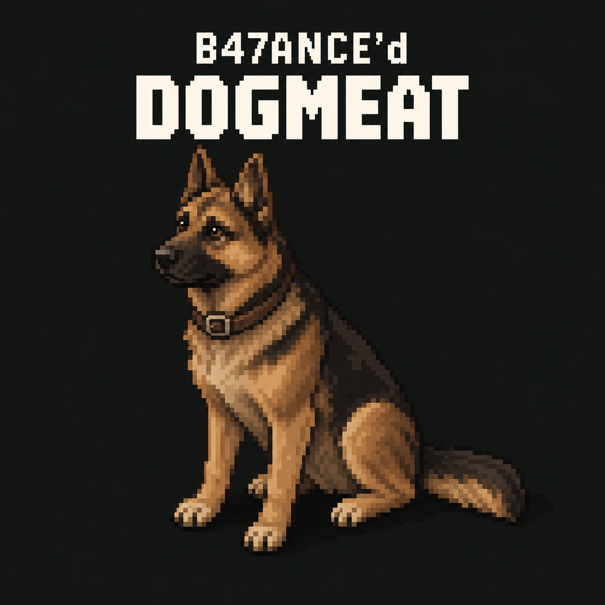

# B47ANCE'd Dog Training

Project Version: 0.2.0-dev.7

The approved transparent German Shepherd is now the mod icon. The project thumbnail and poster are unchanged. The first Workshop item is authorized but **publication is BLOCKED** by five installed native-input mismatches; [publication checks and limitations](docs/WORKSHOP_PUBLICATION.md) record the exact results. This remains a default-off raccoon persistence diagnostic: ownership and live task control are disabled, and SP/dedicated runtime behavior is NOT TESTED.

The new [local Blender anatomy checkpoint, em-v004](art/english_mastiff_anatomy/README.md), adds a real mouth opening, separate mandible, 42 teeth, gums, palate, oral lining, independent tongue, eyeballs and blinking lids to a copy of the original fawn Mastiff. Editable BLEND and reopened FBX/GLB are retained. Facial/visual acceptance remains **HOLD**: upper inner-lip folding and residual surfacing/attachment defects need local finishing. No new Meshy credits or native activation; the raccoon remains the test carrier.

A separately approved [complete-anatomy Meshy preview](art/english_mastiff_anatomy_preview/README.md) consumed 20 credits. Its 23,865-triangle FBX/GLB imports successfully but still fails oral-anatomy acceptance and has 80 welded non-manifold edges. Original files, actual head sections and hashes are retained; no follow-up paid job, texture or rig is activated.

The latest [complete-anatomy assessment](docs/ENGLISH_MASTIFF_ANATOMY_ASSESSMENT.md) records the original Meshy failures, the executed Blender fallback and remaining facial/native gates. No further paid job follows the approved em-v003 preview.

The user stopped the [closed-mouth rig experiment](art/english_mastiff_rig/README.md) on 2026-10-16 and approved one [open-mouth replacement preview](art/english_mastiff_regeneration/README.md) for 20 credits. The downloaded 15,601-triangle FBX/GLB has a cavity and tongue-like geometry, but distinct teeth/gums, jaw articulation and surface defects fail the pre-texturing gate. Texturing and rigging are held; neither candidate is game-ready. The original em-v001 remains unchanged.



The user-selected German Shepherd [project thumbnail](thumbnail.png) is preserved at its original 1254×1254 resolution. Artwork roles and provenance are recorded in [BRANDING.md](docs/BRANDING.md).

An isolated [English Mastiff authoring candidate](art/english_mastiff/README.md) now includes a cleaned 12,476-triangle fawn model, 2K PBR textures, FBX/GLB and editable Blender sources. Two approved Meshy jobs consumed 30 credits. It is unrigged and native compatibility is NOT TESTED; the raccoon carrier, German Shepherd work, project thumbnail and gameplay remain unchanged.

The focused account-binding follow-up now includes a [read-only disposable Lua probe and two-client test procedure](tests/runtime/account_binding/README.md). The native player-to-connection helpers have no verified Lua route; automatic adoption remains BLOCKED. Twenty-five probe cases bring the offline suite to 431. The probe is excluded from ordinary assembly; no server/client launch or dedicated reconnect/restart result is claimed.

The [server-account alternative investigation](docs/SERVER_ACCOUNT_IDENTITY_ALTERNATIVE.md) finds lossless string labels and a useful normal login path, but automatic account binding remains BLOCKED. Slot/replacement aliases, case behavior and rename/delete/recreation require explicit root-account and lifecycle proof. A private realm-scoped principal UUID registry is proposed only; no provider, ownership or task control is activated.

The focused [server SteamID64 audit](docs/STEAMID64_SERVER_PATH_AUDIT.md) retains D1 BLOCKED. NetworkUser.getSteamid is lossless as a string, but its exposed user-list route is a packet mirror; the server writer uses a separate local map. Player.getOwner returns nil and native database/connection helpers have no verified production Lua route. No principal adapter or gameplay enablement was added.

The latest [database/native proof decision](docs/DATABASE_AUTHORITY_GO_NO_GO.md) remains **NO-GO**. The isolated store transaction experiment adds 31 cases (406 offline total) without changing production Lua. Connection-scoped actors and native action candidates do not resolve lossless server identity, native lifecycle, exclusive control or durable commit. The new drift report records five historical failures plus two further package/loose differences; no runtime evidence or installation repair.

Standalone, Lua-only, dedicated-server-first Build42.21 project. M0R contracts remain the technical baseline. A [rebuilt German Shepherd authoring candidate, coat and rig](art/german_shepherd/README.md) exists as gsd-v002 for visual and pipeline review; it has not met the user's realistic visual quality benchmark. The [first feature foundation](docs/FEATURE_FOUNDATION.md) implements offline Lua ownership, naming, handler permissions and private projections. The [native/private persistence prototype](docs/NATIVE_PERSISTENCE_SLICE.md) adds native observation, private identity matching and inactive-slot save preparation. The [loaded-anchor/lifecycle adapter](docs/NATIVE_PAIRING_LIFECYCLE.md) connects explicit native load/start/death events, exact checkpoint recovery and one pending native anchor. The [loadable persistence diagnostic](docs/NATIVE_BOOTSTRAP_TEST.md) now adds an explicit first-store operation, native raccoon test registration and admin menu. The [multiplayer identity investigation](docs/NATIVE_IDENTITY_AUTHORITY.md) now reports recovered private identity independently of untrusted carrier observations. The [server admission guard](docs/NATIVE_ADMISSION_GUARD.md) now refuses nine selected Lua representation transitions and latches integrity failures. In-game save/load remains NOT TESTED; complete native admission coverage and production multiplayer ownership remain blocked. Companion Dogs and DogPack are not dependencies or asset sources.
User-approved technical Mod ID: `B47ANCEDDogmeat` (2026-10-14). The temporary raccoon carrier is approved for save/load testing; the original model is unchanged.

Start with [the current plan](docs/IMPLEMENTATION_PLAN.md), [M0R validation](docs/M0R_VALIDATION.md), [native evidence](docs/M0R_SOURCE_EVIDENCE.md) and [132 current traceability rows](docs/FEATURE_TRACEABILITY_MATRIX.md). The [historical research index](docs/HISTORICAL_RESEARCH_INDEX.md) labels former add-on records; their bytes and observed evidence remain unchanged.

## Current contracts

1. [Standalone canine feasibility](docs/STANDALONE_CANINE_FEASIBILITY.md)
2. [Field ownership](docs/NATIVE_STATE_OWNERSHIP_MATRIX.md)
3. [Canonical identity](docs/CANINE_IDENTITY_CONTRACT.md)
4. [Private persistence/recovery](docs/PRIVATE_PERSISTENCE_RECOVERY_CONTRACT.md)
5. [Task arbitration](docs/TASK_ARBITRATION_CONTRACT.md)
6. [Milestone prerequisites](docs/MILESTONE_DEPENDENCY_GRAPH.md)
7. [Sandbox settings](docs/SANDBOX_SETTINGS_REGISTRY.md)
8. [Localization](docs/LOCALIZATION_CONTRACT.md)
9. [Biology/game-time](docs/CANINE_BIOLOGY_TIME_MODEL.md)
10. [Minimum playable candidate/full roadmap](docs/MINIMUM_PLAYABLE_RELEASE.md)
11. [Multiplayer acceptance](docs/MULTIPLAYER_ACCEPTANCE_MATRIX.md)
12. [Feature traceability](docs/FEATURE_TRACEABILITY_MATRIX.md)
13. [M0R validation/blockers](docs/M0R_VALIDATION.md)

## Source, generated outputs and validation

Authoritative current source is README, VERSION, CHANGELOG, version-inventory.json, current docs/contracts JSON, current Markdown contracts and scripts/validate_m0r.py. Original art source is art/german_shepherd/source (editable .blend and original build/validation scripts), with the original texture and intentional review outputs documented in its asset README. Authoritative feature source is src/domain/B47Dog and src/native/B47Dog; prepared English fallback strings are src/localization across all 29 languages. Exact files and commands are declared in source-inventory.json. Authoritative bootstrap and metadata sources are src/bootstrap and src/metadata. scripts/build_loadable.py assembles and verifies a new B42 development tree without installation or an archive. The retained .m0r-local/loadable-0.2.0-dev.4/B47ANCEDDogmeat tree is an older diagnostic output; current source assembly is validated in disposable temporary output. No Workshop ID exists.

research contains immutable local inspection artifacts excluded from public Git; raw game classes/assets/decompiled code must never ship. .m0r-local authoring/baselines and managed .agents guidance are also local-only. Current contracts preserve all101 original IDs and add31 native/core requirements; the 79-setting catalog remains future design data. The runtime test mode has one default-off server option, an admin context menu and 36 explicit fallback keys across 29 languages (1,044 entries); source-inventory.json declares the exact runtime subset.

From repository root:

```powershell
$m0rPython = 'C:/Users/willi/.cache/codex-runtimes/codex-primary-runtime/dependencies/python/python.exe'
& $m0rPython -B scripts/check_versions.py --root . --json
& $m0rPython -B scripts/validate_m0r.py
& $m0rPython -B scripts/validate_foundation.py
& $m0rPython -B scripts/test_domain.py
& $m0rPython -B scripts/validate_m0r.py --native --game-root 'E:/Program Files (x86)/Steam/steamapps/common/ProjectZomboid'
& $m0rPython -B scripts/validate_foundation.py --native --game-root 'E:/Program Files (x86)/Steam/steamapps/common/ProjectZomboid'
& $m0rPython -B scripts/audit_public_push.py
```

Old validate_audit/collect_evidence commands are historical add-on tools that can overwrite research; they are not current standalone validation. The user authorized feature development on 2026-10-14 and deferred model refinement. The registered raccoon persistence diagnostic is the current test slice; production gameplay remains blocked by native identity authority and persistence gates. No automatic game/server launch, deployment, release archive or Workshop publication.

Public repository: [B47ANCE/B47ANCEDDogmeat](https://github.com/B47ANCE/B47ANCEDDogmeat). Current contracts use the docs/m0r-contracts review branch. GitHub CI checks version/contracts, source/localization/art integrity and actual Lua 5.1 domain tests on Ubuntu; that is offline validation, not Linux PZ/dedicated proof. Native inspection remains local. Public pushes are audited for sensitive/generated/native files and do not authorize main merge or release.

The user supplied the initial 0.1.0-dev.1 scaffold version. Current 0.2.0-dev.7 continues additive MINOR development with server-side completion guards, guarded recovery/provisioning and adversarial admission/restart tests. The prior 0.2.0-dev.6 added approved branding. No storage schema or raccoon registration changes. The art checkpoint remains tested 0.1.0-dev.2; no model files changed.
Future additive training functionality is MINOR scope; dependency versions, PZ builds and data schemas remain independent.
G6 and G7 are NOT TESTED; G8 is BLOCKED. The current 431 offline Lua/file/event/transaction/diagnostic tests do not validate authenticated game actors, native dog lifecycle, durable world saves or multiplayer behavior.

The [native continuity audit](docs/BLOCKER_RESOLUTION_REPORT.md) adds a central refusal policy and nine lifecycle/security documents. ADMIT remains unreachable. The 59 direct native constructor sites and worker/deserializer paths show gaps beyond the nine hooks; a fresh process cannot attest prior-session authenticity. Same dev.7 is retained for this unreleased guard revision. [Operator procedures](docs/MULTIPLAYER_OWNERSHIP_TEST_PLAN.md) distinguish current negative tests from blocked positive ownership acceptance.

[Option A concludes NO-GO](docs/OWNERSHIP_GO_NO_GO_DECISION.md) for automatic authenticated ownership on the verified Lua boundary: serialized fields cannot provide trusted origin, transient IDs cannot survive as a binding, and no complete native policy/save seal was established. The bounded save/load trace and fresh-VM equivalence witness add evidence without changing runtime guards or enabling gameplay. See the [focused disposable procedure](docs/DISPOSABLE_RUNTIME_TEST_PROCEDURE.md); positive identity proof remains blocked.

The [database-authoritative redesign](docs/DATABASE_AUTHORITY_DESIGN.md) now separates permanent logical dogs from session-bound native representations, with natural primary/sub-bond relationships, one active task/handler lease and approved default offline self-care. It is a design proposal with schema/permissions/lifecycle/sandbox/acceptance contracts; no production controller, SQLite interface, storage mode or ownership enablement is implemented. [Validation and remaining gates](docs/DATABASE_REDESIGN_VALIDATION.md) retain Option A NO-GO. Current native-baseline verification FAILS on five changed loose class overrides; the packaged inputs for the new audit match. Historical hashes are preserved and no installed files are repaired.

The input handoff is preserved as a historical requirements artifact under `docs/USER_HANDOFF.md`.
Evidence records are immutable snapshots; they do not establish dedicated runtime correctness.
