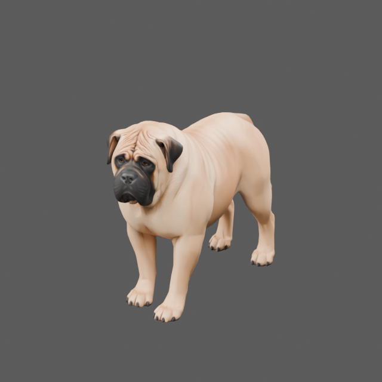

# English Mastiff authoring candidate

Tested Project Version: 0.2.0-dev.7

Asset revision: `em-v001`. Generated through two individually approved Meshy-7.1 jobs: 20 credits for geometry, 10 for 2K PBR texturing, **30 credits total**. This is an isolated, unrigged adult fawn English Mastiff candidate. The raccoon runtime carrier, German Shepherd work, project thumbnail, gameplay and saves are unchanged. No project version bump, installation or publication.



## Deliverables

| File | Purpose |
| --- | --- |
| [interchange/english_mastiff.glb](interchange/english_mastiff.glb) | Cleaned, self-contained PBR review model |
| [interchange/english_mastiff.fbx](interchange/english_mastiff.fbx) | Cleaned FBX with embedded base color, normal, roughness and metallic textures |
| [source/english_mastiff_processed.blend](source/english_mastiff_processed.blend) | Editable packed Blender scene with actual model and review lighting |
| source/meshy_preview.glb and .fbx | Original untextured service output, preserved |
| source/meshy_textured.glb and .fbx | Original textured service output, preserved |
| [source/meshy_textured_textures](source/meshy_textured_textures) | Four original 2048×2048 PNG maps: base_color, normal, roughness, metallic |
| [metadata/generation.json](metadata/generation.json) | Exact prompts/options, job IDs, approval scope, actual costs and reference provenance |
| [validation/artifact_manifest.json](validation/artifact_manifest.json) | File sizes and SHA-256 inventory for this checkpoint |
| [metadata/native_compatibility.json](metadata/native_compatibility.json) | Installed native asset/script fingerprints and compatibility limits |

Preview task `01a14381-3246-76b4-b2cb-760091dad19c`; refinement task `01a14385-b596-72a1-9f09-e29c7414798f`. No additional paid generation, retry, remesh, conversion, rigging or animation job was submitted. The photos guided visual breed/proportion assessment only: they show different animals, collars/scenery and a person, so they were not submitted as matched multi-view inputs or redistributed. No third-party model, texture or rig was acquired. See [Meshy terms](https://www.meshy.ai/terms-of-use) for provider rights; this record does not invent a new asset license.

## Inspection results

| Check | Result and limit |
| --- | --- |
| Generation/download | PASS: both approved jobs succeeded; actual local GLB/FBX/PNG bytes retained |
| Triangle budget | PASS against the handoff's 8,000–15,000 authoring target: original 12,479; cleaned 12,476 |
| Surface structure | PASS within tested scope: one connected welded surface, zero boundary/non-manifold edges, non-finite coordinates or zero-area triangles after cleanup. Self-intersections are NOT TESTED |
| Local cleanup | Three tiny extra fin triangles removed after welding coincident seam geometry. Bounds unchanged; no remesh, sculpt or physical rescale. Original service files preserved |
| UVs | PASS: one UV set. Every retained triangle keeps its original position/UV corners within the validator's 1e-6 rounding; exactly three triangles removed |
| PBR maps/materials | PASS: four 2048×2048 external PNGs, one material. GLB retains identical embedded service image bytes by role; metallic/roughness share a packed image there. FBX uses separate scalar maps and reimports all four textures |
| FBX roundtrip | PASS for 12,476 triangles, closed welded surface, UV layer, texture presence and bounds agreement within 1e-6 Blender units. Complete shader equivalence is NOT TESTED |
| Dimensions | X/Y/Z bounds: 0.653521 / 1.900387 / 1.336694 Blender units. Physical size is NOT CALIBRATED; these are not verified metres or in-game dimensions |
| Orientation | Actual views face toward Blender -Y with Z up. Native alignment/handedness is NOT TESTED |
| Breed/anatomy | PROVISIONAL visual candidate: broad square head, short muzzle, drop ears, heavy chest, substantial torso, separate limbs and hanging tail. Fawn coat/black mask are present. Surface/fur and joint topology still need artist review; this is not approval against the earlier commercial quality benchmark |
| Rig/deformation | BLOCKED / NOT TESTED: zero armatures/actions; no native weights or locomotion. Closed geometry does not establish animation-ready joint edge flow |
| PZ client/dedicated | NOT TESTED; no registration, activation, spawning, physics, hitbox or gameplay-stat change |

Review the actual [side](previews/processed/axis_x_positive.png), [opposite side](previews/processed/axis_x_negative.png), [front](previews/processed/axis_y_negative.png) and [rear](previews/processed/axis_y_positive.png). Geometry-only and original-textured review stages remain under previews; these are Blender renders of the actual downloaded files, not concept illustrations. [local_cleanup.json](validation/local_cleanup.json), [processed.json](validation/processed.json) and [processed_fbx.json](validation/processed_fbx.json) retain the exact measured scope.

The first FBX material roundtrip dropped packed scalar channels. The local exporter was corrected to supply the provider's separate roughness/metallic maps; the final FBX reimport includes all four textures. The independent GLB checker confirms the cleaned GLB's embedded PBR images and roles remain byte-identical to the service GLB.

## Native compatibility and next steps

Installed Build 42.21 / Steam 25485521 defines Raccoon_Body as Skinned/Raccoon_Body using animalEffect, static=false and animationsMesh=Raccoon. Its animation mesh references the Raccoon directory. The installed body is DirectX text X (`xof 0303txt 0032`), not this GLB. Source inspection found 35 named frames and 25 skin-weight names; those counts include helper frames and are not a Mastiff skeleton mapping. The existing independent Shepherd rig is not a verified native canine rig either. No native geometry or animations are redistributed.

1. Review breed shape, wrinkles, paws, underside, isometric silhouette and remaining self-intersection/joint-retopology needs. Keep the original output and this checkpoint recoverable.
2. Establish a verified native canine target hierarchy/bind pose and compatible export/import route. Calibrate real scale and axes against installed animal evidence; FBX/GLB interchange alone is insufficient.
3. Rig and weight a separate Blender development copy against that target, then test joint deformation and custom canine clips, root motion, foot contacts and required transitions. The current [Meshy rigging API](https://docs.meshy.ai/en/api/rigging) documents humanoid inputs; its web app's quadruped feature does not establish MCP dog-rig support. No rigging was attempted.
4. Verify animalEffect texture/shader support, native texture limits, LOD/performance, attachments/equipment/injury visual compatibility, avatar/corpse assets and client loading. Do not infer these capabilities from Blender PBR rendering.
5. Only after separate implementation authorization and satisfied authority/save gates, register a native candidate and run actual SP and dedicated join/rejoin/restart tests. Keep cosmetic ancestry/appearance independent of identity, bonding, weight, strength, hitboxes and movement authority.

Future apricot/brindle coats should reuse this compatible body's geometry and UVs, subject to verified material/skin variation support. Only the fawn coat was generated. Current model/pipeline claims do not establish those variants.

## Reproduction and validation

Use the existing standalone Blender-Python runtime; no dependencies were installed. The authoring scripts reset only their own fresh process and overwrite only their selected Mastiff outputs. Never execute them inside an unsaved interactive scene. Original Meshy files are inputs, not regeneration targets.

From repository root, the exact commands used were:

```powershell
$mastiffBlender = '.m0r-local/art-tools/python313/python.exe'
$mastiffPython = 'C:/Users/willi/.cache/codex-runtimes/codex-primary-runtime/dependencies/python/python.exe'
& $mastiffBlender -B art/english_mastiff/source/inspect_english_mastiff.py --render
& $mastiffBlender -B art/english_mastiff/source/inspect_english_mastiff.py --input art/english_mastiff/source/meshy_preview.fbx --label geometry_fbx
& $mastiffBlender -B art/english_mastiff/source/inspect_english_mastiff.py --input art/english_mastiff/source/meshy_textured.glb --label textured_service --render
& $mastiffBlender -B art/english_mastiff/source/prepare_english_mastiff.py
& $mastiffBlender -B art/english_mastiff/source/inspect_english_mastiff.py --input art/english_mastiff/interchange/english_mastiff.glb --label processed --render
& $mastiffBlender -B art/english_mastiff/source/inspect_english_mastiff.py --input art/english_mastiff/interchange/english_mastiff.fbx --label processed_fbx
& $mastiffPython -B art/english_mastiff/source/validate_english_mastiff.py
& $mastiffPython -B scripts/check_versions.py --root . --json
& $mastiffPython -B scripts/validate_m0r.py
& $mastiffPython -B scripts/validate_foundation.py
& $mastiffPython -B scripts/audit_public_push.py
git diff --cached --check
```

Regenerating an owned output intentionally changes its file hash and requires a new artifact manifest/checkpoint; do not overwrite historical evidence and silently label it current. This is offline Blender/file evidence only. G6 NOT TESTED; G7 BLOCKED / NOT TESTED; stable G8 BLOCKED. Existing native ownership, lifecycle, task-control and persistence blockers remain independent of this art candidate.
