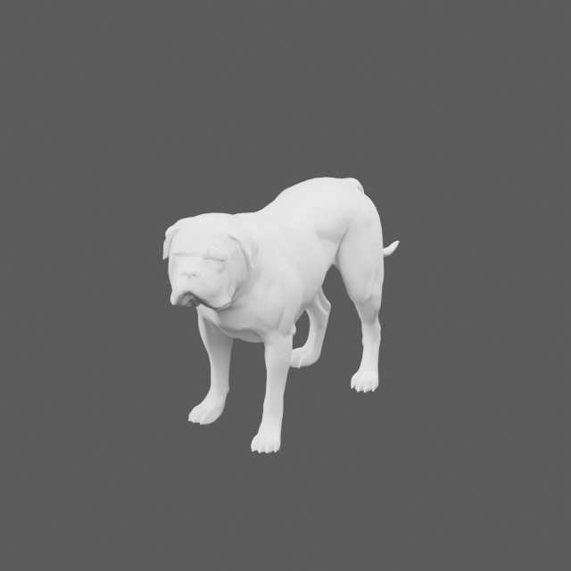

# English Mastiff complete-anatomy preview

Tested Project Version: 0.2.0-dev.7
Asset revision: em-v003-preview. Geometry acceptance: **INCOMPLETE / HOLD**.

The user approved exactly one new 20-credit static geometry job with
"run the meshy 20 credits". Meshy-7.1 task
01a143d2-0b78-7721-a5c2-d1c04780a497 succeeded and consumed 20 credits.
The 785-character prompt prioritized complete internal anatomy, unfused jaw/lip
regions, 42 teeth, gums, palate and a separate tongue with a gently closed mouth.
Target: approximately 23,000 triangles, FBX and GLB, no Ultra surcharge, no
textures or remote motion. No reference photographs were uploaded.

## Download and geometry evidence

| Check | Offline result |
| --- | --- |
| Service / local outputs | SUCCEEDED; both original FBX and GLB retained |
| Blender imports | Both reopen in standalone Blender-Python 5.2.2 LTS |
| Triangles | 23,865; approximate target was 23,000 |
| Welded components | One component, 11,942 vertices |
| Welded surface defects | 52 boundary edges, 80 non-manifold edges |
| Finite/area checks | No non-finite coordinates or zero-area triangles |
| UVs / materials | One UV layer; no material or texture maps |
| Dimensions | 0.536947 × 1.900985 × 1.091065 source Blender units; physical scale uncalibrated |
| Rig / clips | None; no new rigging, skinning or motion job |
| PZ/client/dedicated | NOT TESTED; no active mod change |

Inspect [front](previews/mouth/front.png), [side](previews/mouth/side.png),
[three-quarter](previews/mouth/three_quarter.png),
[underside](previews/mouth/underside.png) and
[midline section](previews/mouth/midline_section.png).
These are actual downloaded-mesh renders with neutral review shading. Section
cuts are temporary in an isolated render process and are not saved back to the
service geometry. An empty head shell exposed by sectioning does not establish
a complete mouth cavity.

## Anatomy acceptance

| Required structure | Result from actual geometry views |
| --- | --- |
| External muzzle / jowls | Present; English Mastiff likeness remains unapproved |
| Complete oral cavity / hard palate | INCOMPLETE: bounded anatomical roof/floor/cheeks/palate not established; a head-shell void is insufficient |
| Distinct tooth classes / upper and lower arches | FAIL: no recognizable complete tooth set demonstrated |
| Upper/lower gums | FAIL: distinct gum structures not demonstrated |
| Independent tongue | INCOMPLETE / UNKNOWN: no separate, usable root/middle/tip tongue established |
| Lower jaw and unfused lips | INCOMPLETE: no controlled mandible/hinge, lip seal or opening/closing test |
| Neutral closed mouth | INCOMPLETE: folded lip surfaces and an underside gap do not prove natural closure |
| Mouth corners / deformable jowls / eyelids | INCOMPLETE: edge flow and deformation not verified |
| Stance / tail / breed | Provisional external form: the side view shows a long tail with an upturned tip; neutral stance and precise English Mastiff likeness still require artistic review |
| Clean surface | FAIL against authoring acceptance: observed non-manifold/boundary defects remain |
| Animation / native compatibility | NOT TESTED |

The higher triangle target did not establish the requested hidden anatomy.
This is a retained static base candidate, not a complete animatable Mastiff.
Texturing cannot repair absent internal structures. No additional paid retry,
texture, remesh or conversion was submitted. All future rigging/skinning and
animation must use Codex-authored Blender/local tools; Meshy motion is prohibited.

## Files and validation

- [Original GLB](source/meshy_preview.glb) and [FBX](source/meshy_preview.fbx).
- [Editable packed review scene](source/english_mastiff_geometry_preview.blend).
- [Exact parameters](preview-parameters.json), [approval](approval.json),
  [generation record](generation.json) and [artifact manifest](validation/artifact_manifest.json).
- [GLB inspection](validation/geometry_preview.json),
  [FBX inspection](validation/geometry_fbx.json) and
  [mouth-view hashes](validation/mouth_views.json).

Commands from repository root, using the existing local runtimes:

    $mastiffBlender = '.m0r-local/art-tools/python313/python.exe'
    $mastiffPython = 'C:/Users/willi/.cache/codex-runtimes/codex-primary-runtime/dependencies/python/python.exe'
    & $mastiffBlender -B art/english_mastiff_anatomy_preview/source/inspect_english_mastiff.py --render
    & $mastiffBlender -B art/english_mastiff_anatomy_preview/source/inspect_english_mastiff.py --input art/english_mastiff_anatomy_preview/source/meshy_preview.fbx --label geometry_fbx
    & $mastiffBlender -B art/english_mastiff_anatomy_preview/source/inspect_mouth.py
    & $mastiffPython -B art/english_mastiff_anatomy_preview/source/validate_preview.py
    & $mastiffPython -B scripts/check_versions.py --root .
    & $mastiffPython -B scripts/validate_m0r.py
    & $mastiffPython -B scripts/validate_foundation.py
    & $mastiffPython -B scripts/audit_public_push.py
    git diff --cached --check

Inventory integrity PASS does not change anatomy HOLD. Preserve this checkpoint;
rerendering changes hashes and requires a new manifest. No dependency install,
game/server launch, gameplay/save/ownership change, raccoon replacement, deployment
or Workshop publication. Project version remains 0.2.0-dev.7 for this isolated art
iteration. G6 NOT TESTED; G7 BLOCKED / NOT TESTED; stable G8 BLOCKED.
