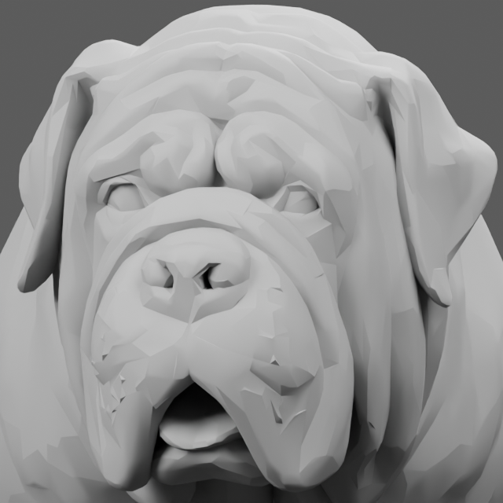

# English Mastiff open-mouth replacement — review held

Tested Project Version: 0.2.0-dev.7
Asset revision: em-v002-preview. Geometry acceptance: **HOLD / NOT APPROVED**.

The user stopped closed-mouth rigging and approved one new Meshy-7.1 geometry
preview for 20 credits. Task 01a143bb-0d56-741e-990f-8926c5d2506a succeeded and
consumed 20 credits. No texturing, paid retry, remesh, conversion, rigging or
animation job was submitted for this replacement.

The preview has an open-mouth recess, cavity and tongue-like internal geometry.
Distinct upper/lower canine teeth, gum lines and clean jaw/lip articulation
could not be verified in the actual front, side, underside and midline-section
renders. The lower mouth includes broad joined surfaces that require topology
inspection/repair before closing-jaw or panting claims. This fails the
pre-texturing mouth acceptance gate; service success is not animation readiness.

| Inspection | Offline result |
| --- | --- |
| GLB and FBX import | Both reopen in standalone Blender-Python 5.2.2 LTS |
| Triangles | 15,601; the 15,000 requested target is approximate, not achieved exactly |
| Surface after coincident-vertex welding | One component, 18 boundary edges, 28 non-manifold edges |
| Finite positions / nonzero triangles | No non-finite coordinates or zero-area triangles found |
| UVs | One UV layer |
| Rig / animations / textures | None; geometry preview only |
| Dimensions | 0.653899 × 1.902136 × 1.032234 source Blender units; physical size not calibrated |
| Mouth / breed fidelity | Provisional visual evidence; mouth requirements incomplete, no quality-standard approval |
| Native/client/dedicated | NOT TESTED; no runtime registration or raccoon replacement |

The [GLB](source/meshy_preview.glb), [FBX](source/meshy_preview.fbx), packed
[Blender review scene](source/english_mastiff_geometry_preview.blend), exact
[parameters](preview-parameters.json), [approval](approval.json), task metadata
and validation manifest are retained. Geometry views are actual Blender renders
of these downloaded bytes. Mouth views use neutral review shading; the
midline section removes one half only inside an isolated render process, never
from the original model. No generated texture or illustrated teeth are used
as evidence. Normal/shading appearance is not an anatomical acceptance test.

The original [em-v001](../english_mastiff/README.md) is unchanged and recoverable.
The [rig experiment](../english_mastiff_rig/README.md) is stopped, unfinished and
not approved. Prior native-loader/shader source findings do not certify this
replacement's import, skinning, scale, animation, sockets or speed matching.

Next geometry gate: establish actual upper/lower gum and tooth geometry,
separate useful jaw/tongue weight regions, inspect the cavity and lip hinge,
and repair the observed surface defects. Reinspect before any texture or rig
work. Another paid job needs separate approval; none is automatically queued.

Asset-only authoring stays within unreleased 0.2.0-dev.7, with no gameplay,
save, configuration or API compatibility change. No game/server launch,
deployment, Workshop publication, stable release or project-version bump.
Ownership/live tasks remain disabled. G6 NOT TESTED; G7 BLOCKED / NOT TESTED;
stable G8 BLOCKED.

Exact inspection commands from the repository root:

    $mastiffBlender = '.m0r-local/art-tools/python313/python.exe'
    & $mastiffBlender -B art/english_mastiff_regeneration/source/inspect_english_mastiff.py --render
    & $mastiffBlender -B art/english_mastiff_regeneration/source/inspect_english_mastiff.py --input art/english_mastiff_regeneration/source/meshy_preview.fbx --label geometry_fbx
    & $mastiffBlender -B art/english_mastiff_regeneration/source/inspect_mouth.py

The scripts only overwrite this candidate's owned review outputs; they must run
in a fresh standalone process. Frozen checkpoints and installed game files are
never output targets. Re-rendering requires a new artifact manifest rather than
silently retaining old hashes.
