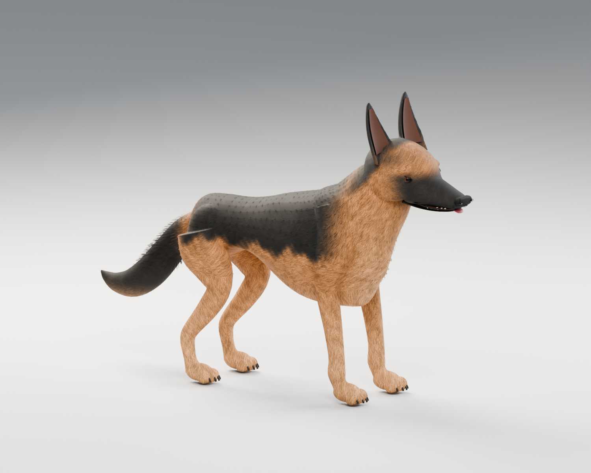

# German Shepherd authoring asset

Project Version: 0.1.0-dev.1

2026-10-14 authoring checkpoint; asset revision `gsd-v001`. Original adult black-and-tan German Shepherd blockout with a standing pose and experimental deformation rig. German Shepherd is the first requested breed. The current asset does **not meet the user's realistic visual quality standard** and has no production art approval; it does not select or implement the proposed native research prototype.



## User's visual quality benchmark — 2026-10-14

The user supplied the [CGTrader Dogs big pack](https://www.cgtrader.com/3d-model-packs/dogs-big-pack) and two screenshots, including a detailed German Shepherd close-up, as the required quality standard. Target: believable real-time dogs with convincing breed anatomy, detailed fur and facial materials, and natural deformation. The references establish the visual benchmark; no commercial model, texture or rig has been acquired or incorporated.

The seller describes 13,000–17,000 triangles per dog, 2048 x 2048 albedo/alpha, surface-property and normal maps, 54–57 bones and four LOD levels. These are seller specifications, not independently tested assets or mandatory PZ settings. Our existing 16,668-triangle count is within that advertised range, yet the visual quality is substantially below the reference. Increasing polygon count alone does not resolve the shape, surface and deformation work.

| Acceptance area | Required result | Current blockout gap |
|---|---|---|
| Breed anatomy | Coherent skull/cheeks/neck, substantial chest, natural shoulder-to-ribcage and pelvis-to-thigh transitions, believable knee/hock placement and paw proportions | Small simplified head, tubular body/limbs and lumpy mass transitions |
| Face and expression | Eyes seated in shaped sockets with eyelids, defined brow, cupped ears, shaped nose/nostrils, mouth interior with teeth and tongue for panting/open-mouth poses | Simple eye/nose shapes, thin lip line and no mouth interior |
| Fur surface | Region-specific hair direction and length, layered color variation, readable undercoat and saddle, fine surface relief and controlled highlights | Smooth coat with broad color masks and slight procedural grain |
| Fur silhouette and paws | Natural neck ruff, chest/haunch/tail feathering, tapered bushy tail, distinct compact toes and integrated claws | Smooth outlines, narrow ear wedges and rounded simplified feet |
| Deformation | Deliberate joint/face topology, skin weights and corrective work that retain volume through locomotion and expressive poses | Triangulated blockout topology and automatic weights tested only with four probes |
| Review evidence | Comparable neutral-light full-body views, head/paw/fur close-ups, clay anatomy views, moving joint checks and readability at the intended PZ camera scale | Current renders show the blockout and pipeline operation; production visual acceptance remains NOT MET |

The next modeling pass must establish accurate anatomy and facial construction before detailed fur/material authoring. Select texture resolution, normal/roughness use and any fur-edge geometry through authoring tests and verified PZ rendering support; the reference screenshots do not prove those shader features work in PZ. Compare the resulting model against this benchmark before expanding to other breeds. Technical export checks, GitHub CI and triangle counts never substitute for visual acceptance.

## Editable source and review files

| File | Purpose |
|---|---|
| [source/german_shepherd.blend](source/german_shepherd.blend) | Canonical editable mesh, UVs, original deformation rig, packed texture and isolated preview studio |
| [source/build_german_shepherd.py](source/build_german_shepherd.py) | Original procedural authoring source; rebuilds owned asset outputs in a fresh standalone process |
| [textures/coat_albedo.png](textures/coat_albedo.png) | Original 1024 x 1024 black-and-tan coat atlas, generated from independently authored spatial masks |
| [interchange/german_shepherd.glb](interchange/german_shepherd.glb) | Skinned, textured review interchange; **not a verified PZ native format** |
| [source/validate_german_shepherd.py](source/validate_german_shepherd.py) | Independent source reopen, provenance, skin, topology and GLB roundtrip checks |
| [validation/asset_validation.json](validation/asset_validation.json) | Exact geometry, dimensions, weights, pose probes and owned output SHA-256 hashes |
| [validation/roundtrip_validation.json](validation/roundtrip_validation.json) | Separate reopened-source and imported-GLB evidence |

The body has 10,500 triangles. Total geometry, including eyes, ear interiors, mouth lines, claws and toe details, has 16,668 triangles across 42 mesh objects. One original 29-bone deformation skeleton has independent front/rear upper, lower, pastern and foot bones on both sides, head/jaw/ears, trunk and four tail bones. All vertices have normalized weights with at most four influences. These are measured authoring counts, not an established PZ performance budget. Native LODs remain unimplemented.

Authoring conventions: metres, Z up, head +X; identity mesh/armature object transforms, root at the body centerline near the floor. The GLB exporter uses its glTF axis conversion and the roundtrip restores the measured world-space bounds. PZ axes, units, rest skeleton, attachment conventions and importer mapping remain [UNKNOWN]. Bone labels are original authoring names, not claimed native engine identifiers.

## Provenance and visual intent

No third-party or vanilla dog mesh, rig, texture, animation, photograph or sculpt was imported, traced or copied. Body geometry, accessories, UVs, coat painting function, weights and studio are independently authored in the included build script. Anatomy references informed general proportions only: the [FCI/SV breed standard](https://www.fci.be/Nomenclature/Standards/166g01-en.pdf) and [AKC breed standard](https://cdn.akc.org/GermanShepherdDog.pdf). The selected approximately 62 cm withers target and moderate standing silhouette are art choices, not a veterinary or conformation assessment.

The supplied consolidated handoff was consulted as reference: this base corresponds to a large shepherd body concept and one requested coat. Other coat variants, breed genetics, mixed ancestry, equipment/bandages, injury clips, diagnostic visuals and hidden-condition metadata are not implemented. There are no authored action clips or root-motion proof. The posed render is an isolated deformation probe, not a locomotion animation or medical state.

## Tested boundary and reproduction

[TESTED Windows offline] Blender Python 5.2.2 LTS / CPython 3.13.7; NumPy and Pillow authoring tools. The official `bpy` wheel was used in an isolated, ignored local toolchain because no live Blender connection was available. Tools are not shipped with the art or required by a runtime mod. Run from repository root in a **fresh standalone process**; the builder resets that process's scene and overwrites only its owned asset outputs.

Exact commands used on this machine:

```powershell
$assetPython = '.m0r-local/art-tools/python313/python.exe'
& $assetPython -B art/german_shepherd/source/build_german_shepherd.py
& $assetPython -B art/german_shepherd/source/validate_german_shepherd.py
$docsPython = 'C:/Users/willi/.cache/codex-runtimes/codex-primary-runtime/dependencies/python/python.exe'
& $docsPython -B scripts/check_versions.py --root . --json
& $docsPython -B scripts/validate_m0r.py
& $docsPython -B scripts/audit_public_push.py
```

The build and independent checks pass: closed, connected main body; no degenerate body faces; finite geometry; normalized skin weights; portable packed texture; valid UVs; preserved triangle count/bone names/hierarchy/bounds and four nontrivial head/foreleg/hindleg/tail deformation probes after GLB reimport. Imported UV seam vertices are welded only in a disposable topology-check copy at 0.000001 m tolerance. Source and export files are not altered by that check. Poses reset to neutral in both the saved source and GLB.

The builder's optional `--no-render` creates an intermediate source/export checkpoint, marks previews unrendered and excludes cached previews from its new provenance. Complete validation rejects that checkpoint until the default build rerenders all seven views. This rejection was tested before the final default rebuild and passing validation; older images cannot silently establish current visual evidence.

Visually inspected [three-quarter](previews/german_shepherd.png), [side](previews/side.png), [front](previews/front.png), [rear](previews/rear.png), [clay](previews/clay.png), [deformation probe](previews/deformation_check.png) and [160-pixel silhouette](previews/silhouette_160.png). These remain blockout/pipeline evidence. Subsequent user-supplied references establish a realistic quality target that this asset does not meet. Automatic weights need animation-driven refinement and native rig mapping. The geometry is triangulated authoring topology, not a completed animation retopology pass. The recorded structural test results remain evidence for their original scope only.

[RUNTIME GATE] PZ import, native definitions/registration, rest skeleton mapping, enabled-state animation set, corpse/avatar/attachments, runtime performance and dedicated synchronization are **NOT TESTED**. T-ASSET remains unpassed. G6 NOT TESTED; G7 BLOCKED / NOT TESTED; G8 BLOCKED. No game/server launch, deployment, runtime package, Workshop publication, stable tag or main merge was performed.

Canonical project version remains unchanged: no shipped gameplay, API, save or sandbox behavior changed. `gsd-v001` identifies this art checkpoint separately from project SemVer. The original M0R evidence remains dated historical evidence and is not relabeled as asset or runtime validation.
