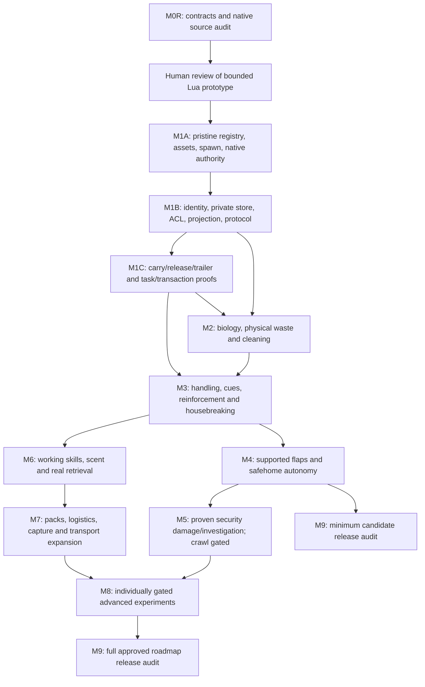

# Milestone dependency graph and gates

Project Version: 0.2.0-dev.2

M0R contract, 2026-10-12. FEASIBLE planning; no implementation/runtime gate passes. M0R document completion does not approve M1 code. [Traceability](FEATURE_TRACEABILITY_MATRIX.md), [acceptance](MULTIPLAYER_ACCEPTANCE_MATRIX.md), [minimum candidate](MINIMUM_PLAYABLE_RELEASE.md).

Arrows are technical prerequisites, not permission to skip runtime gates. Each bounded gameplay slice requires G4 static, G5 offline logic and operator G6/G7 appropriate to its surfaces before dependent gameplay expands. Dedicated gameplay G7 PASS is mandatory before G8. M1C contains individual proof sub-slices, not a demand to implement every later vehicle. Client UI/localization, sandbox design, diagnostics, Linux case audit and manual updates accompany every slice; M9 consolidates them.

| Milestone | Entry criteria | Scope / foundational consumers | Exit criteria | Current status |
|---|---|---|---|---|
| M0R | Latest Lua-only policy and approved gameplay requirements; discovered version | Thirteen contracts, native evidence, all feature IDs, settings/localization, corrected entry points | Structural/version checks; explicit blocker inventory and reviewable prototype scope; public backup reported honestly | Documentation work only |
| M1A | Explicit prototype approval; pristine evidence plan; original asset rights | Definition/load-order/model/animation/avatar and one controlled server spawn; native movement/damage boundaries | T-ENVIRONMENT/REGISTRY/ASSET/NATIVE; no competing or client simulation; G6/G7 recorded separately | BLOCKED / NOT TESTED |
| M1B | M1A plus approved nonsecret carrier/private storage design | Durable ID/world pairing, observer/handler/owner ACL, projection allowlist, protocol mismatch handling | T-IDENTITY/PRIVACY/AUTH/PROTOCOL/RECOVERY; no orphan reinitialization; two-client restart/unload | BLOCKED / NOT TESTED |
| M1C | M1B; each native transition/API mapped | Carry/release/trailer identity, exclusive task seam, inventory transactions before any consumer | T-TRANSPORT/T-TASK/T-TRANSACTION and recoverable physical commit receipts; maturation separately T-GROWTH | BLOCKED / NOT TESTED |
| M2 | M1B, task/transaction proof for care/cleaning; physical object API proof | Traits/history; native read-only needs; owned biology; real urine/feces, decay/cleaning and basic welfare | T-BIOLOGY/WASTE/RECOVERY, all representation modes or explicit unsupported gates; no double catch-up | BLOCKED / NOT TESTED |
| M3 | M2; ACL before projection; resource transactions and task seam | All foundation cues, independent records, discovery, rolling XP, human knowledge, leash, positive reinforcement, housebreaking/zones | T-TRAINING/CUES/BIOLOGY/INPUT; anti-farming and time calibration; native force/stumble separately gated | BLOCKED / NOT TESTED |
| M4 | M3; supported door matrix, native selective collision/path proof | Install/remove/repair, access/size/lock, learned physical dog traversal, potty/home routines; electronic/power subgate | T-DOOR/HOME/BIOLOGY/TRANSACTION; opposite approaches, blocked exits and power interruptions | BLOCKED: selective flap seam |
| M5 | M4 for flap surfaces; independently proved native zombie stimuli/damage | Damage/investigation/audio and dog alerts; crawl only after separate collision transition proof | T-SECURITY; no claims of entry without actual native traversal; no duplicate zombies | BLOCKED / NOT TESTED |
| M6 | M3 plus scent evidence and unique item claims | Odor registry/training/search, real retrieval, hunting/foraging/fishing and guard; optional identifiers only | T-SCENT/WORK/TRANSACTION; human trails/water/environment each own gate | BLOCKED / NOT TESTED |
| M7 | M6; per-dog writer and native occupancy proofs | Original roster/social/task influence, group eligibility, real container logistics, capture/kennels; new vehicles separately | T-PACK/LOGISTICS/TRANSPORT; no shared-load duplication or inherited proficiency | BLOCKED / NOT TESTED |
| M8 | Relevant prior milestones and separately reviewed Lua capability | Canine alternate-lore/reanimation, dragging/shared physics/corpses, redirection/restraint/trucks/throwers | T-ADVANCED plus specialized source/runtime proof; unsupported paths remain blocked | BLOCKED / NOT TESTED |
| M9 | Declared candidate scope achieved; all applicable G6/G7 evidence on exact revision | Full manual/localization/input/performance/migration/Linux/compatibility/version/release-surface audit | G7 PASS then authorized G8 artifacts/checks; no version mismatch; explicit publication authorization | BLOCKED |

## Required cross-cutting ordering

Handler identity/authorization exists in M1B before any private projection. Inventory safety in M1C precedes M2 cleanup/care, M3 reinforcement, M4 construction and M6 retrieval. Task/native writer arbitration precedes autonomous needs/training/work. Carry/trailer continuity is tested before those transports are enabled; growth and every other vehicle require their own proof before support. No dependency on Companion Dogs/DogPack is introduced to bypass a missing native gate.

Deep regional veterinary damage/treatments/grooming and severe rehabilitation are explicit M2-health sub-slices after condition-specific writer/treatment proof, continuing through M3/M6 as their content grows. Equipment variants, occupations/books/VHS belong to M3 content sub-slices. Breed assets/location/POI population belong to M2-population sub-slices after original definition and spawn receipts. UI starts at M1B, expands each slice, and is never held until release. See per-feature rows for precise placement; a broad milestone label does not close a feature's acceptance.
